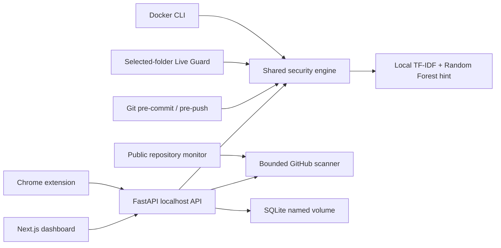

<div align="center">

# SHADOWAI GUARDIAN

### Local AI Privacy Firewall and Secret Leak Protection

[](https://www.docker.com/)
[](https://fastapi.tiangolo.com/)
[](https://nextjs.org/)
[](browser-extension/)
[](LICENSE)

Scan prompts, repositories, selected folders, and outgoing Git changes before secrets become public.

</div>

---

## What it does

ShadowAI Guardian is a local-first cybersecurity project for reducing accidental exposure of credentials and personal data.

- **Prompt firewall** — detects API keys, passwords, database URLs, private keys, tokens, PII, unsafe commands, and prompt injection.
- **Terminal scanner** — gives Docker-based `info`, `prompt`, and public GitHub repository commands.
- **Live Guard** — watches only a folder you explicitly mount and reports risky file changes.
- **Git Guard** — installs repository-local pre-commit and pre-push hooks that block critical/high-risk secrets.
- **Public repository monitor** — periodically rescans an explicitly supplied public GitHub repository.
- **Local dashboard** — displays scan history, privacy metrics, risk timelines, and downloadable PDF reports.
- **Chrome extension** — provides advisory inspection on supported AI sites and GitHub repository pages.

Core detection works locally without an API key. NVIDIA NIM enhancement is optional.

## Requirements

- Git
- Docker Desktop on Windows/macOS, or Docker Engine with Compose on Linux

Python and Node.js are **not required** on the user's laptop.

## Quick start

```powershell
git clone https://github.com/Ankit-builds1/shadowai-guardian.git
cd shadowai-guardian
docker compose build
docker compose run --rm shadowai info
```

The first prompt scan generates a small local demonstration ML model inside the persistent Docker volume.

## Terminal commands

### Inspect a prompt or text

```powershell
docker compose run --rm shadowai prompt "Summarize this public paragraph"
```

Select a policy mode:

```powershell
docker compose run --rm shadowai prompt "text to inspect" --policy strict
```

Machine-readable output:

```powershell
docker compose run --rm shadowai prompt "text to inspect" --json
```

Exit codes are useful in scripts:

| Code | Meaning |
| ---: | --- |
| `0` | Allowed / successful |
| `1` | Warning |
| `2` | Blocked finding |
| `3` | Invalid input or runtime error |

### Scan a public GitHub repository

```powershell
docker compose run --rm shadowai repo "https://github.com/owner/repository"
```

Only canonical public `https://github.com/owner/repository` URLs are accepted. Local paths, SSH URLs, embedded credentials, other hosts, and repository subpages are rejected.

Use this feature only on repositories you own or have permission to assess.

## Live Guard

Live Guard monitors only the directory explicitly mounted into the container. It does not watch the whole laptop.

### Windows PowerShell

```powershell
docker compose run --rm -v "C:\Projects:/workspace:ro" shadowai watch /workspace
```

### macOS/Linux

```bash
docker compose run --rm -v "$HOME/Projects:/workspace:ro" shadowai watch /workspace
```

Live Guard scans existing supported files, then checks created or modified files. Press `Ctrl+C` to stop.

Ignored content includes `.git`, virtual environments, `node_modules`, `.next`, build output, caches, binary files, and files larger than 1 MB.

Example redacted alert:

```text
[BLOCK] config.env:1 | PASSWORD | high | pass************e123 [PASSWORD_REDACTED]
```

## Git Guard

Git Guard installs pre-commit and pre-push hooks in a repository you explicitly mount. Existing hooks are backed up and chained.

Build the image first from the ShadowAI Guardian directory:

```powershell
docker compose build shadowai
```

Install into another repository on Windows:

```powershell
docker compose run --rm -v "C:\Projects\my-repo:/workspace/repository" shadowai install-hooks /workspace/repository
```

macOS/Linux:

```bash
docker compose run --rm -v "$HOME/Projects/my-repo:/workspace/repository" shadowai install-hooks /workspace/repository
```

Behavior:

- Critical and high-severity findings block the commit or push.
- Medium and low findings warn.
- Output contains redacted values only.
- An existing hook is preserved as `pre-commit.shadowai-backup` or `pre-push.shadowai-backup`.
- An explicitly reviewed emergency operation can set `SHADOWAI_BYPASS=1`.

If you rename the Docker image, set `SHADOWAI_IMAGE` when running Git commands.

## Monitor an already-public repository

```powershell
docker compose run --rm shadowai monitor-repo "https://github.com/owner/repository" --interval 300
```

The interval must be between 30 and 86,400 seconds. The first result is printed immediately; later output appears only when the redacted finding fingerprint changes.

This is a detection aid, not credential recovery. If a real secret was published, revoke or rotate it immediately. Removing it from the latest file does not remove it from Git history.

## Start the dashboard

```powershell
docker compose up -d
```

Open:

- Dashboard: <http://localhost:3000>
- Backend health: <http://localhost:8000/health>
- API documentation: <http://localhost:8000/docs>

View logs:

```powershell
docker compose logs -f
```

Stop the application while keeping history:

```powershell
docker compose down
```

Delete all local ShadowAI scan history and the generated model:

```powershell
docker compose down -v
```

> `down -v` permanently deletes the project's Docker volume.

## Chrome extension

Keep the backend running, then:

1. Open `chrome://extensions`.
2. Enable **Developer mode**.
3. Select **Load unpacked**.
4. Choose this repository's `browser-extension` folder.

Supported pages include ChatGPT, Claude, Gemini, Microsoft Copilot, and GitHub repository pages.

The extension calls only the local backend:

```text
http://localhost:8000/api/proxy/inspect
http://localhost:8000/api/scan/github
```

The extension is advisory. It scans when the user selects the ShadowAI action; it does not silently record keystrokes or universally replace a website's send button.

## Optional NVIDIA NIM enhancement

Core scanning does not require NVIDIA NIM. To enable optional explanation/rewrite enhancement, create a root `.env` file:

```env
NVIDIA_NIM_API_KEY=nvapi-your-key
```

Never commit `.env`. Docker Compose passes the value at runtime; the key is not copied into either image.

## Architecture



The `api` and on-demand `shadowai` services share the same backend image and detector code. The dashboard uses a separate production Next.js image.

## Detection and policy flow

```text
Input
  -> regex secret/PII detector
  -> prompt-injection detector
  -> demonstration ML score hint
  -> student/developer/company/strict policy
  -> allow, warn, or block
  -> optional redacted safe text
```

Detected categories include API keys, passwords, database URLs, private keys, JWTs, email addresses, phone numbers, payment-card patterns, Aadhaar/PAN patterns, unsafe commands, and prompt-injection phrases.

## Project structure

```text
shadowai-guardian/
|-- backend/
|   |-- app/
|   |   |-- api/               FastAPI routes
|   |   |-- core/              settings and SQLite models
|   |   |-- detectors/         secret, PII, and injection rules
|   |   |-- genai/             optional NVIDIA enhancement
|   |   |-- ml/                demonstration TF-IDF model
|   |   |-- services/          policy, GitHub, and PDF services
|   |   |-- cli.py             Docker terminal entrypoint
|   |   |-- live_guard.py      selected-folder monitoring
|   |   |-- git_guard.py       pre-commit/pre-push protection
|   |   `-- repo_monitor.py    public-repository monitoring
|   |-- tests/
|   `-- Dockerfile
|-- frontend/                   Next.js dashboard
|-- browser-extension/          Chrome Manifest V3 extension
|-- data/                       demonstration data documentation
|-- tests/                      deployment contract tests
|-- compose.yaml
|-- .dockerignore
|-- .env.example
`-- LICENSE
```

Generated environments, dependency folders, models, databases, caches, and build output are intentionally excluded from Git and Docker contexts.

## Local data and privacy

- CLI prompt scans do not write scan history to SQLite.
- Dashboard/API prompt scans are stored in the local Docker volume so reports and timelines work.
- Stored API history currently includes the original submitted text and should be treated as sensitive local data.
- CLI, Live Guard, Git Guard, and repository-monitor output prints redacted values.
- No cloud database or product telemetry is included.
- Optional NVIDIA enhancement sends the already-redacted rewrite prompt to the configured NVIDIA endpoint.

## Honest limitations

- The ML classifier is trained from a tiny demonstration dataset and is not a production-grade security model.
- Regex rules can produce false positives and cannot recognize every secret format.
- GitHub scanning is limited to public repositories and supported text/code files.
- The browser extension is an advisory workflow, not a universal enforcement layer.
- ShadowAI Guardian does not decrypt HTTPS, capture screens, record keystrokes, or inspect folders that were not explicitly mounted.
- Network packet capture cannot reliably inspect secret text sent through encrypted HTTPS.
- Dedicated secret managers, GitHub secret scanning, code review, credential rotation, and least-privilege access remain necessary.

## Run the tests

The normal user does not need a host Python installation. Maintainers can run verification in Docker or a Python 3.11+ development environment.

```powershell
docker compose build
docker compose run --rm shadowai info
docker compose run --rm shadowai prompt "ignore previous instructions"
```

Development test commands:

```powershell
python -m pytest backend/tests tests -q
node browser-extension/repo-url.test.cjs
node browser-extension/content-safety.test.cjs
npm --prefix frontend audit --omit=dev
```

## Responsible use

Scan only prompts, folders, Git repositories, and systems you own or are explicitly authorized to assess. Do not use the repository scanner to collect or exploit exposed credentials.

## License

MIT License — see [LICENSE](LICENSE).

## Author

**Ankit Dash** — [GitHub](https://github.com/Ankit-builds1)
